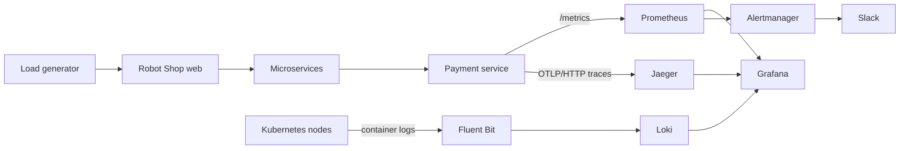

# Observability architecture

The application runs in the `robot-shop` namespace. Prometheus, Grafana, Loki, Fluent Bit, Jaeger, and Alertmanager run in `observability`. The payment service is the reference service for the three golden signals implemented in this project:

- Request rate from `http_requests_total`.
- Error ratio from 5xx responses divided by all payment responses.
- Latency from the `http_request_duration_seconds` histogram.

Fluent Bit runs as a DaemonSet, enriches container records with Kubernetes metadata, and sends them to Loki. The payment service exports spans over OTLP/HTTP to Jaeger and automatically traces Flask handlers plus outgoing Requests calls.

The repository includes four narrowly scoped Trivy exceptions for inaccurate package records in the official Python image's attached third-party SBOM. Each reported package was verified against the final container filesystem: `msgpack` and `setuptools` are absent, while `urllib3` is already the fixed `2.8.0` release. These exceptions must be reviewed when the Python base digest changes.
